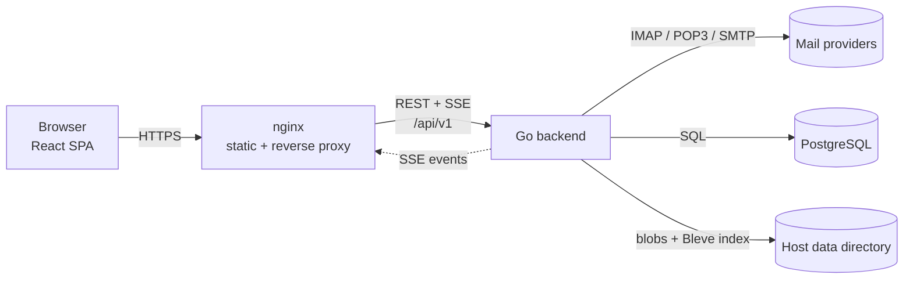

# MailQuay

[简体中文](README_CN.md) | English

MailQuay is a self-hosted webmail client for mailboxes that already exist. It connects to providers over IMAP, POP3, and SMTP, keeps a synchronized copy of mail on your own server, and serves a React single-page frontend to any browser.

MailQuay is not a mail server. It does not run an MTA, does not own a domain, and does not deliver mail between servers. It is the client layer for mainstream hosted mailboxes, self-hosted IMAP or POP3 servers, and any other standards-compliant mailbox.

> **Status:** v0.1.0, the first release. Use the published binaries or the Compose stack; `make build-full` builds from source.

## Goals

- **Server-side sync.** Mail is fetched, indexed, and cached by the backend, so every browser sees the same state without a desktop client running.
- **One inbox, many accounts.** Unified views across accounts while preserving per-account folders and provider semantics.
- **Standards first.** IMAP, POP3, and SMTP only. No provider-specific SDK is required to read or send mail. Every protocol accepts a custom host and port.
- **Self-hosted and private.** Credentials are encrypted at rest, mail bodies stay on your server, and remote content in HTML mail is blocked by default.
- **Boring operations.** One Go binary, one database, one data directory, and Docker Compose.

## Features

- Multi-account unified inbox, folder tree, and unread counts.
- IMAP synchronization of folders, flags, and message metadata, with background body prefetch and on-demand fetch for the rest.
- POP3 compatibility mode for providers that only expose POP3: one virtual inbox, polling, UIDL tracking, and local-only flags.
- Per-account sync range (all time by default, or 1 day to 1 year) and download scope (headers, full without attachments, or full with attachments), fetched and indexed in the background.
- Per-account protocol configuration with custom host, port, and TLS mode for IMAP, POP3, and SMTP.
- Import mailbox accounts from an eM Client desktop database; existing addresses and OAuth2 accounts stay disabled.
- Runtime settings (sync intervals, limits, OAuth apps, log level) stored in PostgreSQL and edited in the web UI; public URL, CORS, trusted proxies and insecure-host exemptions come from environment variables.
- Conservative sync and fetch concurrency with user overrides; search and index pools default to conservative CPU-based sizing with a switch to set them by hand.
- Compose, reply, forward, drafts, attachments, scheduled send, and a retrying outbox with a configurable retry limit.
- Every account sends from its own address; set a default sender name and Reply-To per account, and edit Reply-To per message.
- Local marked mail keeps full bodies and attachments and survives account removal by default.
- Local archive stores an independent full copy that survives remote deletion and account removal.
- Delete moves mail to Trash and leaves cleanup to the provider.
- Structured search combines subject/all mode with account, folder, recipient, sender, and attachment filters.
- Unified views deduplicate the same message across folders with a stable provider ID, Message-ID, or content hash fallback.
- Non-HTTPS access outside loopback and private ranges shows a permanent red warning above the app.
- Two backend builds: `mailquay` with embedded frontend assets, and `mailquay-core` as API-only.
- Centered settings dialog over the mail shell with dedicated navigation, account settings, sync, and appearance.
- OAuth2 (XOAUTH2) for providers that require it, plus app passwords for generic IMAP or POP3 servers.
- Server-sent events for new mail, flag changes, task progress, and outbox state.
- A top-right task ring shows running, queued, and failed work with per-task colors and a hover panel; failures stay red until handled.
- Embedded full-text search with Bleve, including a CJK analyzer and IMAP server-side search as a fallback.
- Sandboxed HTML rendering, remote images blocked by default, and attachment download hardening.
- English and Simplified Chinese UI.

## Non-goals

- Acting as an SMTP server or MTA.
- POP3 folder or flag synchronization. POP3 has no folder or server-side flag model; MailQuay keeps those locally.
- Multi-tenant hosting. The data model is single-owner with multiple mail accounts.
- Calendar, contacts, or team collaboration in the first release.

## Architecture

The browser only talks to the backend HTTP API. The backend owns IMAP, POP3, and SMTP connections, credential encryption, synchronization state, MIME parsing, search indexing, and outbox delivery. The frontend is stateless and can be served from any static host.

## Technology

| Layer | Choice | Reason |
| --- | --- | --- |
| Backend | Go 1.27+ | Predictable concurrency for long-lived IMAP connections and a single static binary. |
| HTTP | `net/http` + chi | Standard library semantics, small surface, middleware-friendly. |
| Database | PostgreSQL 18 | Concurrent sync workers, JSONB metadata, and transactional state in one store. |
| DB access | `pgx/v5` + `sqlc` | Native PostgreSQL types and typed queries without an ORM. |
| Search | Bleve v2 (scorch) | Embedded full-text index, CJK bigram analyzer, no external search service. |
| IMAP | `go-imap` v2 | Streaming parser, IDLE, QRESYNC, and context-aware operations. |
| POP3 | `net` + `bufio` | UIDL, TOP, RETR, DELE, STARTTLS and QUIT semantics without a second client library. |
| SMTP | `github.com/emersion/go-smtp` | Submission, STARTTLS, and XOAUTH2 support. |
| MIME | `go-message` | Standards-compliant message parsing without hand-rolled boundary handling. |
| Migrations | `goose` | Embedded PostgreSQL schema and versioned migrations. |
| Frontend | React 19 + TypeScript + Vite | Client-side rendering with a fast development loop. |
| Routing | react-router | Client-side routing over one `index.html`; deep links fall back to the app shell. |
| Server state | TanStack Query v5 | Cache, optimistic updates, and SSE-driven invalidation. |
| UI | Tailwind CSS v4 + shadcn/ui | Accessible Radix primitives with full local control of styles. |
| Realtime | Server-sent events | One-way server push with up to three reconnect attempts and simple cookie auth. |

## Repositories

| Repository | Contents |
| --- | --- |
| [`MailQuay`](https://github.com/Yeqingky/MailQuay) | Go backend, database migrations, deployment files, API contract, React frontend under `frontend/`, documentation. |

## Documentation

- [Architecture](docs/architecture.md): system design, synchronization model, realtime transport, security, deployment.
- [Project structure](docs/project-structure.md): repository layout, module responsibilities, data model, API surface.
- [Development](docs/development.md): local setup, environment variables, migrations, testing, Git workflow.
- [Open questions](docs/questions/README.md): numbered decisions that still need an answer.
- [AGENTS.md](AGENTS.md): repository rules for coding agents and contributors.

## License

[MIT](LICENSE)
