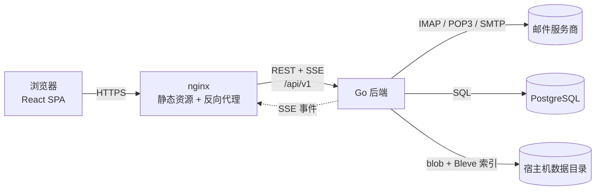

# MailQuay

简体中文 | [English](README.md)

MailQuay 是一个面向已有邮箱的自托管 Web 邮件客户端. 它通过 IMAP, POP3 和 SMTP 接入邮件服务商, 在自己的服务器上保存同步副本, 并向任意浏览器提供 React 单页前端.

MailQuay 不是邮件服务器. 它不运行 MTA, 不持有域名, 也不负责服务器之间的投递. 它是主流托管邮箱, 自建 IMAP 或 POP3 以及其他标准邮箱的客户端层.

> **状态:** v0.1.0, 首个正式版本. 使用已发布的二进制或 Compose 栈; 从源码构建执行 `make build-full`.

## 目标

- **服务端同步.** 邮件由后端拉取, 索引和缓存, 任意浏览器看到同一份状态, 不依赖桌面客户端常驻.
- **一个收件箱, 多个账号.** 提供跨账号统一视图, 同时保留每个账号自己的文件夹和服务商语义.
- **标准优先.** 只使用 IMAP, POP3 和 SMTP. 读写邮件不依赖任何服务商专用 SDK. 三种协议都支持自定义主机和端口.
- **自托管与隐私.** 凭据加密存储, 邮件正文留在自己的服务器, HTML 邮件默认阻止远程内容.
- **运维简单.** 一个 Go 二进制, 一个数据库, 一个数据目录, 以及 Docker Compose.

## 功能

- 多账号统一收件箱, 文件夹树, 未读数.
- IMAP 同步文件夹, 标志和邮件元数据, 后台预取正文, 其余按需拉取.
- POP3 兼容模式: 单个虚拟收件箱, 轮询, UIDL 跟踪, 标志仅保存在本地.
- 添加账号时选择同步范围 (默认所有时间, 可选 1 天到 1 年) 和下载范围 (仅邮件头, 不含附件, 或包含附件), 后台异步拉取和索引.
- 每个账号可配置收信协议, 以及 IMAP, POP3, SMTP 各自的主机, 端口和传输安全.
- 支持从 eM Client 桌面版数据库导入邮箱账号, 已存在的邮箱和 OAuth2 账号不可选.
- 运行时参数 (同步间隔, 限制, OAuth 应用, 日志级别) 存储于 PostgreSQL, 通过网页修改; 公开地址, CORS, 可信代理和非安全传输豁免通过环境变量配置.
- 同步与拉取并发使用保守默认值并可由主人修改; 搜索与索引默认按检测到的容器 CPU 保守推荐, 关闭自动调整后可手动填写.
- 写邮件, 回复, 转发, 草稿, 附件, 定时发送, 以及可配置重试次数的发件队列.
- 每个邮箱账号使用自己的地址发信; 账号可设置默认发信名称和默认 Reply-To, 单封邮件的 Reply-To 在写邮件时编辑.
- 本地标记邮件保留完整正文和附件, 默认在删除账号后仍然保留.
- 本地归档保存独立完整副本, 远端删除和删除账号都不影响.
- 删除可以移动到 Trash 交给服务商清理, 也可以使用本地保留队列按天数到期删除.
- 全部和搜索结果按稳定去重键合并同一封邮件, 依次使用服务商消息 ID, Message-ID 和原文哈希兜底.
- 结构化搜索支持标题/全部模式, 并可组合账号, 文件夹, 收件人, 发件人和附件条件.
- 非 HTTPS 且不在 loopback 或私网范围时, 应用顶部显示不可关闭的红色安全提醒.
- 后端分为 `mailquay` (内嵌已构建前端) 和 `mailquay-core` (仅提供 API).
- 居中浮层的设置弹窗, 包含账号设置, 同步和外观.
- 需要 OAuth2 的服务商使用 XOAUTH2, 通用 IMAP 或 POP3 使用应用专用密码.
- 通过 Server-Sent Events 推送新邮件, 标志变化, 任务进度, 发件状态和运行日志控制台.
- 内容区右上角的任务环显示运行中, 待运行和失败任务, 不同任务使用不同颜色, 失败保持红色直到处理; 悬停展开任务面板.
- 基于 Bleve 的内嵌全文搜索, 支持 CJK 分析器, IMAP 账号额外以服务端搜索作为兜底.
- 沙箱化 HTML 渲染, 默认阻止远程图片, 附件下载加固.
- 英文和简体中文界面.

## 非目标

- 不充当 SMTP 服务器或 MTA.
- 不做 POP3 文件夹或标志同步. POP3 没有文件夹和服务端标志模型, 这些状态只保存在本地.
- 不做多租户托管. 数据模型是单所有者, 多邮箱账号.
- 首个版本不包含日历, 联系人和团队协作.

## 架构

浏览器只访问后端 HTTP API. 后端负责 IMAP, POP3 和 SMTP 连接, 凭据加密, 同步状态, MIME 解析, 搜索索引和发件投递. 前端不保存业务状态, 可以部署在任意静态托管上.

## 技术选型

| 层次 | 选择 | 原因 |
| --- | --- | --- |
| 后端 | Go 1.27+ | 长连接 IMAP 并发模型清晰, 产物是单个静态二进制. |
| HTTP | `net/http` + chi | 贴近标准库, 接口面小, 中间件生态简单. |
| 数据库 | PostgreSQL 18 | 并发同步, JSONB 元数据和事务状态集中在一个存储. |
| 数据库访问 | `pgx/v5` + `sqlc` | 原生 PostgreSQL 类型和类型安全查询, 不引入 ORM. |
| 搜索 | Bleve v2 (scorch) | 内嵌全文索引, CJK 二元组分析器, 不依赖外部搜索服务. |
| IMAP | `go-imap` v2 | 流式解析, 支持 IDLE 和 QRESYNC, 操作可绑定 context. |
| POP3 | `net` + `bufio` | 自行实现 UIDL, TOP, RETR, DELE, STARTTLS 和 QUIT 语义, 不引入第二个客户端库. |
| SMTP | `github.com/emersion/go-smtp` | 提交, STARTTLS 和 XOAUTH2 支持. |
| MIME | `go-message` | 标准兼容的解析, 避免手写 boundary 处理. |
| 迁移 | `goose` | 内嵌 PostgreSQL schema 与版本化迁移. |
| 前端 | React 19 + TypeScript + Vite | 客户端渲染, 开发反馈快. |
| 路由 | `react-router` | 单个 `index.html` 上的客户端路由, 深链接回落到应用壳. |
| 服务端状态 | TanStack Query v5 | 缓存, 乐观更新, 由 SSE 驱动失效. |
| UI | Tailwind CSS v4 + shadcn/ui | 基于 Radix 的可访问组件, 样式完全可控. |
| 动画 | Motion | spring 和进出场动画, 遵循系统的减少动态效果设置. |
| 实时推送 | Server-Sent Events | 单向推送, 最多重连 3 次, 直接复用 Cookie 认证. |

## 仓库

| 仓库 | 内容 |
| --- | --- |
| [`MailQuay`](https://github.com/Yeqingky/MailQuay) | Go 后端, 数据库迁移, 部署文件, API 合同, `frontend/` 下的 React 单页前端, 开发文档. |

## 文档

- [架构](docs/architecture.md): 系统设计, 同步模型, 实时传输, 安全, 部署.
- [项目结构](docs/project-structure.md): 仓库布局, 模块职责, 数据模型, API 面.
- [开发文档](docs/development.md): 本地启动, 环境变量, 数据库迁移, 测试, Git 工作流.
- [待确认问题](docs/questions/README.md): 按编号排列, 等待逐个回答.
- [AGENTS.md](AGENTS.md): 面向编码代理和贡献者的仓库规则.

## 许可证

[MIT](LICENSE)
