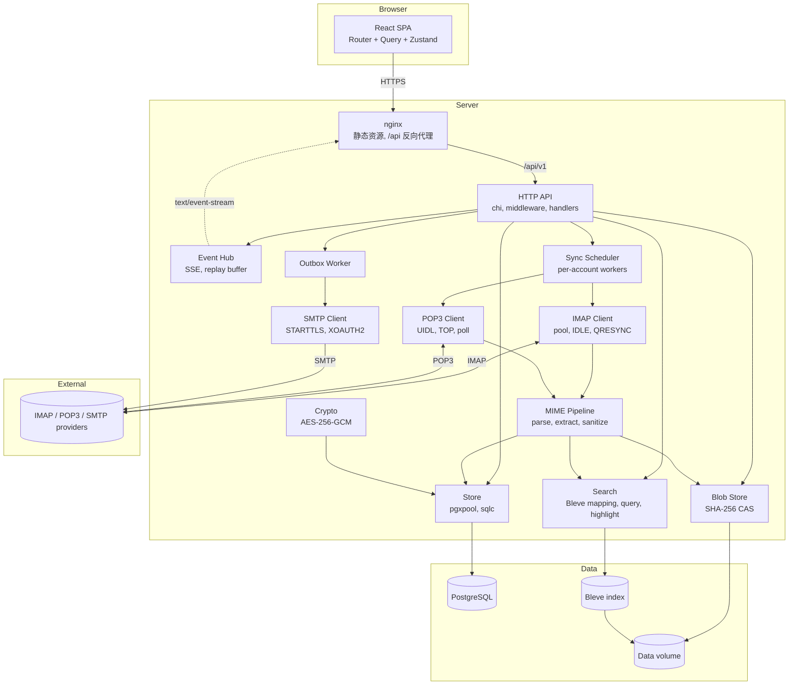
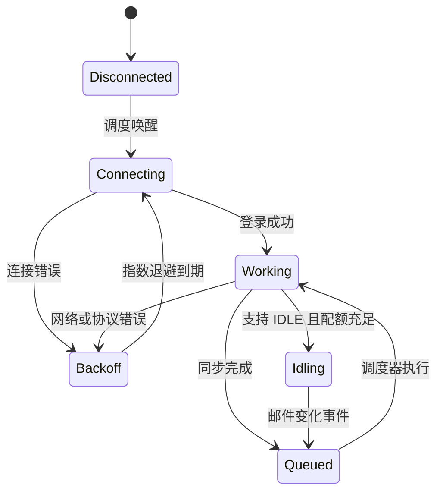
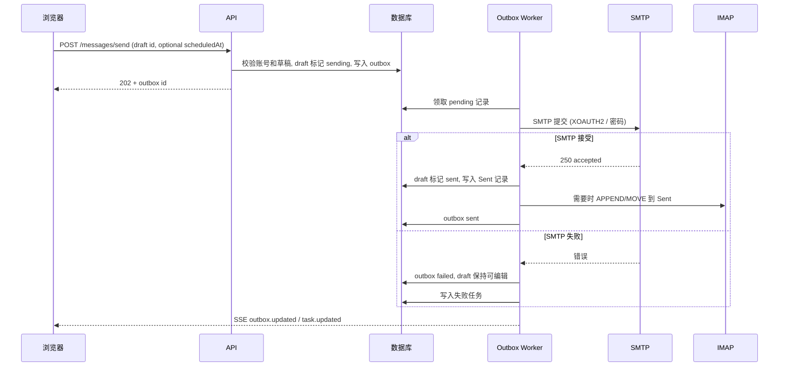
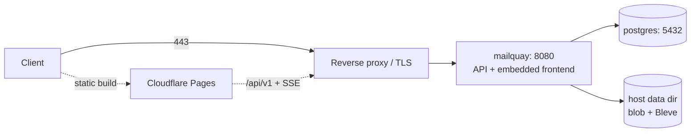

# 架构设计

本文描述 MailQuay 的系统边界, 关键决策, 同步模型, 实时推送, 安全模型和部署拓扑. 目录与模块划分见 [project-structure.md](project-structure.md), 本地开发与配置见 [development.md](development.md).

## 1. 定位与边界

MailQuay 是已有邮箱的客户端层, 不是邮件基础设施.

| 负责 | 不负责 |
| --- | --- |
| 通过 IMAP 或 POP3 读取和同步邮件 | 接收外部服务器投递的邮件 |
| 通过 SMTP 提交待发邮件 | 运行 MTA, DNS, SPF, DKIM, DMARC |
| 在本地保存邮件元数据, 正文缓存和索引 | 成为某个域名的权威邮件存储 |
| 管理多个邮箱账号和统一视图 | 多租户注册, 计费, 组织管理 |
| 向浏览器提供 REST API 和事件流 | 在浏览器内直接连接 IMAP/POP3/SMTP |

服务端持有长期连接和凭据, 浏览器只处理展示与交互. 这个边界决定了凭据不会下发到前端, 同步可以在没有浏览器打开时继续, 多设备看到一致状态.

## 2. 组件



后端是单个 Go 进程. 同步 worker, 发件 worker, HTTP 服务和事件中心共享同一个存储层, 通过数据库事务和进程内事件总线协作. 进程重启后, 未完成的操作从数据库恢复.

## 3. 关键决策

| 决策 | 选择 | 理由 |
| --- | --- | --- |
| 部署形态 | 单用户自托管, 多邮箱账号 | 认证和数据模型保持简单, 符合个人和家庭服务器场景. |
| 数据库 | 只支持 PostgreSQL 18 | 并发同步, JSONB 元数据和事务状态集中在一个存储; 只维护一套迁移和一套 SQL. |
| 数据库访问 | `pgx/v5` + `sqlc` | 原生 PostgreSQL 类型, 生成类型安全查询, 不引入 ORM. |
| 全文搜索 | Bleve v2 (scorch) | 内嵌索引, 中文使用 CJK 二元组分析器, 不增加搜索服务; 索引可从 PG 和 blob 重建. |
| 收信协议 | IMAP + POP3 兼容模式 | IMAP 提供完整的文件夹, 标志和 IDLE 同步; POP3 只用于兼容仅有 POP3 的服务商. |
| 发信协议 | SMTP | 唯一标准提交方式, 支持 STARTTLS 和 XOAUTH2. |
| 端口配置 | 全部可自定义 | IMAP, POP3, SMTP 的主机和端口均由账号配置, 默认值只用于预填, 不写死. |
| 账号认证 | OAuth2 + 应用专用密码 | 主流托管服务商已关闭基础认证, 通用 IMAP/POP3 通常只支持密码. |
| 实时推送 | Server-Sent Events | 只需要服务端到客户端的单向通知, SSE 自动重连且复用 Cookie. |
| 前端渲染 | CSR | 无 SEO 需求, 静态托管简单, 交互密度高. |
| 邮件存储 | 原始 MIME 存入内容寻址 blob | 保留完整原文, 解析结果可重建, 附件天然去重. |
| HTML 清洗 | bluemonday + DOMPurify | 服务端先白名单清洗, 客户端再清洗一次, 降低缓存和解析差异带来的风险. |
| UI | Tailwind + shadcn/ui | 三栏高密度界面需要完全控制布局和间距. |

## 4. 邮件接入

### 4.1 邮箱账号与凭据

只有邮箱账号是 ID 化实体. 用户名, 密码和连接地址直接存在账号上, 不再拆出独立的凭据或连接记录.

账号字段:

- 基础: `id`, `email`, `name`, `provider`.
- 发信身份: `default_send_name`, `default_reply_to`; 默认发信名称为空时使用 `name`.
- 认证: `username`, `auth_type` (`password` 或 `oauth2`), `password_enc`, `oauth_provider`, `oauth_scopes`, `oauth_refresh_enc`.
- 收信: `receive_protocol` (`imap` 或 `pop3`), `imap_addr`, `pop3_addr`.
- 发信: `smtp_addr`, 可为空; 为空表示只收不发.
- 发信凭据: `smtp_username`, `smtp_password_enc`, 为空时回退到账号的 `username` 和密码.
- 连接: `imap_security`, `pop3_security`, `smtp_security`, `smtp_helo_hostname`.
- 同步: 范围, 下载范围, 发送副本策略, 同步开关.

地址格式:

- 存储为 `域名:端口` 或 `IP:端口`, 端口必填.
- IPv6 使用 `[地址]:端口`.
- 不把主机和端口拆成两个字段; 解析时校验端口范围 1-65535.
- 传输安全单独存 `implicit_tls`, `starttls` 或 `none`, 不由端口推断.
- 默认值只用于表单预填: IMAP 993/143, POP3 995/110, SMTP 465/587/25.

规则:

- 新增账号时选择收信协议; 选 IMAP 时填 `imap_addr`, `pop3_addr` 为空; 选 POP3 时相反. `smtp_addr` 可空.
- 发信始终使用账号自身的邮箱地址和 SMTP; 账号可配置默认发信名称, 留空时使用账号显示名称.
- 删除账号时同时删除账号上的加密密码和 OAuth token; 默认保留的标记邮件按标记规则处理.
- 收信和发信分别鉴权: IMAP/POP3 使用账号 `username` 和密码, SMTP 使用 `smtp_username` 和 SMTP 密码; 未单独设置时复用收信凭据.
- API 永远不返回密码或 token, 只返回 `hasPassword`, `hasSmtpPassword`, `hasOAuth` 等状态.
- 连接测试按账号 ID 执行, 使用已保存的地址和凭据, 不信任前端临时传入的主机或密码.

凭据使用 AES-256-GCM 加密后入库. 主密钥来自 `MAILQUAY_SECRET_KEY`, 不写入数据库. 加密时使用账号 ID 作为附加认证数据, 防止密文被搬到其他账号. OAuth2 refresh token 只存一份, access token 只放在内存.

OAuth2 流程:

1. 前端打开 `GET /api/v1/oauth/{provider}/start`, 该接口要求已登录会话, 后端生成 `state` 和 PKCE verifier, 存入短期表, 重定向到服务商.
2. 回调 `GET /api/v1/oauth/{provider}/callback` 是唯一无需会话的 OAuth 接口, 校验 `state`, 用授权码换取 refresh token 和 access token.
3. refresh token 写入账号的 `oauth_refresh_enc` 并加密; access token 只放在内存, 过期前刷新.
4. IMAP, POP3 和 SMTP 按服务商能力使用 XOAUTH2, 每次连接前取有效 access token. POP3 的 OAuth 支持取决于服务商, 不支持时回退到应用专用密码.

自动发现:

- `POST /accounts/discover` 只接收邮箱地址, 返回建议的主机, 端口, 传输安全和 OAuth 服务商; 不校验密码, 也不创建账号.
- 查找顺序: 内置服务商表, 域名 MX 记录识别托管平台, 域名的 `autodiscover` 和 `autoconfig` 端点.
- `autodiscover` 与 `autoconfig` 并行请求, 只使用 HTTPS, 单个请求 4 秒超时, 响应体上限 1 MB, 不跟随非 HTTPS 重定向.
- 内置表覆盖常见公共邮箱; 自定义域名的 Microsoft 365 和 Google Workspace 通过 MX 记录识别.
- 识别到 Microsoft 或 Google 平台时返回 `oauthProvider`, 前端默认选择 OAuth2; 其他域名仍使用密码或应用专用密码.
- 发现结果只是预填建议, 保存前由用户确认, 后端仍按账号输入重新校验主机和端口.

内置服务商参数:

| 服务商 | IMAP | POP3 | SMTP | Scope |
| --- | --- | --- | --- | --- |
| Google | `imap.gmail.com:993` | `pop.gmail.com:995` | `smtp.gmail.com:465` | `https://mail.google.com/` |
| Microsoft | `outlook.office365.com:993` | `outlook.office365.com:995` | `smtp.office365.com:587` | `offline_access`, `https://outlook.office.com/IMAP.AccessAsUser.All`, `https://outlook.office.com/SMTP.Send` |

OAuth 应用凭据保存在 `settings` 表, 在设置页的"OAuth 应用"分组填写. 回调地址固定为 `{MAILQUAY_PUBLIC_URL}/api/v1/oauth/{provider}/callback`, 必须在服务商控制台登记.

Google 的 `https://mail.google.com/` 属于受限 scope. 公开分发前需要完成 Google OAuth 验证; 自用测试模式需要把账号加入测试用户, token 也会在测试模式到期后失效.

### 4.2 IMAP 与 POP3 同步

生产同步以账号为单位串行, 同一账号的文件夹操作也串行; 不同账号并行, 但共享服务器级连接和同步并发配额. IDLE 事件, 定时同步, 启动检查, 打开文件夹和手动同步统一进入调度器. 同账号同文件夹的重复任务合并; 运行中再次收到变化时, 当前任务完成后重新检查, 避免丢失事件.

默认每 10 分钟检查 INBOX, 每 15 分钟检查其他启用文件夹, 周期带 ±10% 随机抖动. 首次 IDLE 连接探测到服务器不宣告 IDLE 时, 该账号的 INBOX 改用 `no_idle_sync_interval_seconds` (默认 180 秒) 轮询; 探测结果保存在进程内, 服务重启或账号更新后重新探测, 设置页提示间隔过短可能触发服务商限流. 打开文件夹会以高优先级请求该文件夹增量同步. 自动同步, IDLE 实时接收和启动检查可分别关闭; 手动同步仍可用. 单文件夹可设为 `full` / `pull` / `off`, 通过 `PATCH /mailboxes/{id}` 修改; 本地文件夹不可配置.



IMAP 连接池:

- 每账号默认最多 2 条连接: 一条专用 INBOX IDLE 连接和一条可复用工作连接; 上限可设为 1-3.
- 每账号上限为 1 时, 同一连接在 IDLE 与工作之间复用; 工作到来会中断 IDLE, 完成后重新监听.
- 工作连接空闲超过 10 分钟后关闭; 复用前发送 `NOOP` 检查连接. IDLE 每 25 分钟结束并重进, 不发送额外的定时 `NOOP`.
- 不支持 IDLE 的服务器使用周期同步. 若总连接配额无法容纳每个活跃账号的一条 IDLE 连接, 以及每账号上限大于 1 时所需的并发工作连接, 则不启动 IDLE, 避免监听占满工作连接配额.
- 不同账号连接共享主机级连接数限制和连接尝试间隔; 主机级同步并发限制独立于连接数限制. 连接和同步配额均按主机共享, 忽略端口.

初次同步:

1. `LIST` 获取文件夹并映射角色: `inbox`, `sent`, `drafts`, `trash`, `junk`, `archive`. 自动识别时顺序是特殊用途标志, 常见文件夹名称(含中英文), 最后按路径排序; 每个角色只保留一个文件夹, 其余降级为 `custom`, 否则侧边栏, 删除目标和全局计数会指向不确定的文件夹. 关闭自动识别后只使用账号配置的路径; 配置的路径不存在时该角色保持未识别, 不回退.
2. 对每个启用的文件夹 `SELECT`, 记录 `UIDVALIDITY` 和 `UIDNEXT`.
3. 按 UID 区间分批 `FETCH` 原始头 (`BODY.PEEK[HEADER]`), 标志, 大小和 `BODYSTRUCTURE`, 每批默认 50 封, 由设置 `envelope_batch_size` 控制.
4. 本地解析头部的 `Message-ID`, `References`, `In-Reply-To`, 主题, 地址和日期, 归并线程; 不请求 IMAP `ENVELOPE`, 避免服务端的畸形结构拖垮整批.
5. 写入消息元数据, 更新文件夹计数, 然后进入正文预取队列.

增量同步:

- 支持 `CONDSTORE` 时读取 `HIGHESTMODSEQ`, 并用 `UID FETCH ... CHANGEDSINCE` 更新变更标志; 不支持时回退到 UID 增量搜索和最近窗口标志刷新.
- 当前锁定的 `github.com/emersion/go-imap/v2 v2.0.0-beta.8` 未提供 QRESYNC `SELECT` / `VANISHED` API, 因此不能启用 QRESYNC 删除变更同步.
- `UIDVALIDITY` 变化表示服务端重建了 UID 空间, 清空该文件夹的本地消息并重新同步, 同时丢弃该文件夹的 `pending_ops`, 避免用旧 UID 执行写操作.
- 标志对账在邮箱增量同步中按 `HIGHESTMODSEQ` 执行; 不再用独立的 15 分钟轮询.
- 已读状态变更, 移动和删除在本地提交后立即重算受影响文件夹的 `total` 和 `unread`, 并推送 `mailbox.updated`; 侧边栏计数不等待下一轮同步.
- 本地移动先把消息 UID 置空, 由 `pending_ops` 里的 `move` 执行远端移动; MOVE 或 COPY 返回目标 UID (`COPYUID`) 时立即回写, 并按目标 UID 删除并发同步可能插入的重复行.
- 服务端不返回目标 UID 时, 目标文件夹同步遇到 uid 为空且 `message_id_header` 相同的行直接收养, 更新 UID, 标志和去重键, 不再插入第二份.
- 启动时清理 uid 为空且同一文件夹内已有同 `dedupe_key` 同步行的占位行; 这类行只删除本地并清理搜索文档, 不排队远端操作.
- 一轮同步中途连接断开时立即中止本轮: `mailsession` 丢弃死连接, 按随机指数退避重试一次. 首次尝试不写入文件夹错误; 重试仍断线时只把该文件夹标记失败并结束本轮, 账号同步保持成功, 未尝试的文件夹保持原状态.

IDLE 连接:

- 每个账号仅监听 INBOX; IDLE 的 `EXISTS`, `EXPUNGE` 和 `FETCH` 变化会退出监听, 排入该邮箱的增量同步, 完成后重新进入 IDLE.
- 每轮 IDLE 最长 25 分钟, 到期主动结束并重入, 不额外发送周期 `NOOP`.
- 不支持 IDLE 时记为不支持并依靠周期同步; 认证失败停止自动重试并提示更新凭据.
- 每主机连接尝试默认至少间隔 2 秒, 服务器连接数与同步并发数独立限制且由所有账号共享. 手动同步也遵守配额; 服务器限流时降低自适应并发并延迟重试.
- 自动重连启用时, 连接失败按指数退避和随机抖动重试; 禁用时不自动重连. 自动同步关闭只停止定时任务, 不屏蔽用户触发的同步.

初始同步范围:

- 时间范围使用下拉框: `all` (默认), `1d`, `3d`, `1w`, `1m`, `1y`; 保存为 `initial_sync_range`.
- 下载范围使用下拉框: `full_no_attachments` (默认), `headers`, `full_with_attachments`; 保存为 `download_scope`.
- 全局设置提供这两个默认值; 新增账号时预填, 单个账号可以覆盖. 修改设置只影响新账号, 已有账号在账号设置中单独修改.
- `all` 处理选中文件夹的全部邮件; 其他范围只处理 cutoff 之后的邮件, 更早邮件保留在服务器, 打开时按需拉取.
- `headers` 只缓存邮件头, 列表显示收发信人和主题; 正文和附件打开时联网拉取, 离线不可读.
- `full_no_attachments` 缓存邮件头和正文, 保留正文引用的 `cid:` 内嵌图片, 普通附件打开时联网拉取; 这是默认值.
- `full_with_attachments` 缓存正文和附件, 可以离线阅读.
- POP3 用 `TOP` 取头, 其余范围用 `RETR`; POP3 不支持部分拉取, 选 `full_no_attachments` 时仍下载整封但只保留文本部分, 附件打开时重新拉取.
- 初始同步是后台任务, 进度写入 `tasks` 表并推送到前端, 不阻塞登录和已有邮件浏览.

同步范围和下载范围变更:

- 设置中的默认值只影响新账号; 已有账号保留自己的范围, 在账号设置中单独修改.
- 已有账号修改范围或下载范围时, 立即写入 `scope_reconcile` 任务, 异步拉取或清理本地数据.
- 扩大同步范围或下载范围: 补拉新增范围内的元数据, 正文或附件.
- 缩小同步范围: 删除范围外邮件的本地元数据, 缓存和搜索文档; 不删除远端邮件.
- 缩小下载范围: 删除不再需要的正文或附件缓存, 保留邮件头, 元数据和正文内嵌图片; 不删除远端邮件.
- 标记邮件, 本地保留邮件和本地归档不受清理影响, 始终保留完整内容.
- 对账任务可中断续跑, 进度进入任务中心; 失败显示红色并允许重试.

正文缓存:

- `full_no_attachments` 的后台正文预取单封上限 2 MiB; 超过上限的邮件按需拉取, 不阻塞初始同步.
- `headers` 不预取正文; 搜索只覆盖主题和地址.
- `full_with_attachments` 预取附件, 单个附件仍受 25 MiB 上限约束.
- 每账号并发 2; 正文提取成功后写入文本缓存和 blob.
- 阅读器从邮件详情获取 CID 图片附件元数据; 详情列表为空时回退正文响应, 已读/标记更新返回空附件列表时保留已有非空附件, 确保切换邮件后再次打开仍可显示内嵌图片.
- 本地搜索覆盖已缓存正文; IMAP 账号在结果不足或查询明确要求全量时追加 `SEARCH` 并合并去重, POP3 账号只搜索本地缓存.
- 正文提取成功后, 邮件入库事务同时写入 `search_jobs`; indexer 异步更新 Bleve, 索引延迟不阻塞阅读.

#### POP3 兼容模式

POP3 没有文件夹, 服务端标志和 IDLE. 兼容层不模拟不存在的语义, 按以下规则工作:

- 每个 POP3 账号只有一个虚拟收件箱 (`role=inbox`). Sent, Drafts, Trash, Archive 是本地文件夹 (`local_only=true`).
- 同步使用 `STAT`, `UIDL`, `LIST`; 新 UIDL 优先用 `TOP n 0` 取头部, 服务端不支持 TOP 时用 `RETR` 取全文.
- 轮询间隔由设置页的 POP3 轮询间隔控制, 默认 5 分钟; 没有 IDLE.
- 已读, 标记, 归档只写本地, 不回传服务器.
- 默认在服务器保留副本 (`pop3_leave_on_server=true`), 避免多个客户端或服务端其他设备丢信.
- 删除默认只影响本地. 开启 `pop3_delete_on_server` 后, 移入已删除文件夹或永久删除时执行 `DELE`, 并且必须在同一会话 `QUIT` 才提交; 失败进入重试.
- 发送成功后无法 APPEND 到服务器 Sent, 在本地 Sent 文件夹保存副本.
- UIDL 不可用时退化为 `Message-ID` + 日期 + 大小的哈希标识, 并在界面提示可能重复.
- 同一邮箱同时配置 IMAP 和 POP3 会产生两份独立数据, 添加账号时警告, 不自动合并.

| 能力 | IMAP | POP3 |
| --- | --- | --- |
| 文件夹 | 是 | 否, 单个虚拟收件箱 |
| 已读同步 | 是 | 否, 仅本地 |
| 标记 | 本地 | 本地 |
| 删除同步 | 是 | 可选 `DELE` |
| 新邮件推送 | IDLE | 轮询 |
| 服务端搜索 | `SEARCH` | 无 |
| 追加到 Sent | `APPEND` | 本地副本 |

#### TLS 套件兼容

- IMAP 建连使用 TLS 1.2 及以上, 证书按系统根证书校验, 不跳过校验.
- 只有 `139.com` 和 `10086.cn` 的 IMAP 主机在 ECDHE 套件之外额外提供静态 RSA 套件 (`TLS_RSA_WITH_AES_128_GCM_SHA256`, `TLS_RSA_WITH_AES_256_GCM_SHA384`); 其他主机沿用 Go 默认套件列表.
- 中国移动邮件网关在 ClientHello 未携带静态 RSA 套件时直接回 `handshake_failure`, 即使客户端同时提供了 ECDHE 套件; 该行为只出现在 IMAP 入口, 同一域名的 POP3 和 SMTP 入口不受影响.
- 套件顺序保持 ECDHE 在前, 服务端支持前向保密时不会退化为静态 RSA.

#### IMAP 客户端标识

- 认证完成后, 若 `CAPABILITY` 含 `ID`, 客户端发送 `ID ("name" "MailQuay" "version" "<构建版本>")`, 与 Thunderbird 的标识方式一致.
- 网易 163/126/188/yeah 在 `LOGIN` 成功后仍要求这条标识; 缺失时所有文件夹的 `SELECT` 都返回 `NO ... Unsafe Login`, 与文件夹本身无关.
- 只对宣告 `ID` 能力的服务器发送; 命令被拒绝时忽略错误, 连接继续使用, 其他服务商不受影响.
- 版本由 `cmd/mailquay` 启动时通过 `imapclient.SetVersion` 注入, 未注入时为 `dev`.

### 4.3 发信



- 发件窗口顶部显示发件账号, 点击打开账号选择; 每个邮箱账号一项, 显示 `默认发信名称 <邮箱>`.
- `From` 由账号邮箱和默认发信名称组成, 默认发信名称为空时使用账号显示名称; 发信凭据来自该账号的 SMTP 配置.
- 账号保存 `default_send_name` 和 `default_reply_to`; 默认 Reply-To 用于新邮件的预填.
- Reply-To 在写邮件窗体中编辑, 默认使用账号的默认 Reply-To, 未配置时使用发件人邮箱; 草稿把 Reply-To 存在 `headers.replyTo`.
- 任意邮箱账号都可以用于发送或回复.
- 点击回复或转发时, 默认使用当前邮件所属邮箱账号; 用户可以在发送前切换到其他账号.
- 新建邮件默认使用当前选中邮箱账号; 在全部账号视图下使用上次使用的账号, 没有记录时用第一个账号.
- 原邮件所属账号已删除时, 回退到当前账号, 并在发送窗口提示该邮件是本地保留副本.
- 发送前生成稳定的 `Message-ID`, 写入草稿并随 outbox 保存, 重试时复用; outbox 同时保存 `account_id` 和 `draft_id`.
- 发送前不复制邮件. 草稿是唯一来源, outbox 只引用草稿; 发送成功后把草稿标记为 `sent`, 生成已发送记录并移出草稿列表, 不做删除.
- 支持定时发送: 写邮件窗口选择日期和时间, 按用户时区转换后以 UTC 写入 `outbox.scheduled_at`; 到期前状态为 `scheduled`.
- 定时发送到期前不会连接 SMTP; worker 只领取 `scheduled_at <= now` 的记录, 然后转为 `pending`.
- 编辑已定时发送的草稿会取消定时, 回到草稿编辑状态; 用户重新选择发送时间.
- 发送失败时草稿原地保留, 不移动到已发送, 不删除; outbox 标记 `failed`, 任务中心显示失败任务, 等待用户编辑, 重试或取消.
- 自动重试次数在设置中配置, 默认 3 次; 永久错误不重试.
- 用户取消发送只把 outbox 标记为 `cancelled`, 草稿继续保留.
- 附件从 blob 流式读取, 不整体载入内存.
- 默认要求 TLS. `none` 只允许显式配置, 并在界面标注风险.
- 成功响应 `250` 后, 按账号的 `sent_copy_mode` 处理副本: `auto` 交给服务商自动复制, `append` 由后端 `APPEND` 到服务器 Sent, `none` 不写副本; POP3 账号只写本地 Sent.
- SMTP 已接受但 Sent 副本写入失败时, 草稿标记 `copy_failed`, outbox 标记 `copy_failed`, 在任务中心提示用户手动重试副本; 不重新发送邮件.
- 重试采用指数退避, 次数由设置 `send_retry_limit` 控制, 默认 3 次. 认证失败, 收件人拒绝等永久错误直接进入 `failed`, 草稿保持可编辑, 由任务中心展示原因.
- 进程启动时把超过租约时间的 `sending` 记录重置为 `pending`; 重发前用 `Message-ID` 在 Sent 文件夹做一次存在性检查, 降低重复发送概率.
- 投递语义是至少一次. 进程在收到 `250` 后崩溃仍可能造成重复发送, 不做静默去重; 界面在重试前提示.

### 4.4 一致性模型

- IMAP 账号以服务端邮箱为唯一事实来源, 本地数据库是镜像和缓存; POP3 账号的正文和 UIDL 以服务器为准, 标志与本地文件夹以本地为准.
- 用户操作先写本地并立即返回. IMAP 账号同时写入 `pending_ops`, 由同步 worker 按顺序提交; POP3 账号只修改本地状态, 服务器删除仅在显式开启时执行.
- 同一邮箱的操作串行执行. 标志操作可合并, 移动和删除按 UID 顺序执行.
- POP3 不支持标志和移动同步, `pending_ops` 对 POP3 只承载可选的服务器删除操作.
- 移动优先使用 `UID MOVE`; 服务端不支持时退化为 `UID COPY` + `STORE \Deleted` + `UID EXPUNGE`, 并先确保目标文件夹存在.
- 提交失败进入重试; 永久失败回滚本地乐观状态并推送 `message.updated`.
- 搜索索引通过 `search_jobs` 跟随邮件状态. 索引允许短暂落后, 但删除任务优先处理, 避免搜索结果指向已删除邮件.
- 下一次增量同步会覆盖本地状态, 远端值优先. 冲突不弹窗, 以最终对账结果为准.

### 4.5 文件夹模型

侧边栏分两层: 上方是标题"邮件"和全局收藏夹, 下方是邮箱账号列表. 账号默认折叠, 展开后显示系统文件夹和该账号的"其他". 全局没有"其他".

账号同步失败时, 账号行右侧的未读数之后显示红色三角形按钮. 点击在浮层中列出失败来源和错误文本: 文件夹级失败显示文件夹名, 账号级连接失败显示"账号连接"; 没有错误详情时显示通用提示. 按钮不触发展开或折叠, 下一次同步成功后提示自动消失.

| 层级 | 入口 | 类型 | 数据来源 | 同步 |
| --- | --- | --- | --- | --- |
| 全局 | 全部收件 | virtual | 收件箱, 垃圾邮件和自定义文件夹的并集, 排除 Sent/Drafts/Trash | 只读 |
| 全局 | 未读 | virtual | 同上, `unread=true` | 只读 |
| 全局 | 已发送 | server `\Sent` | 所有账号的 Sent | pull-only, 全局开关 |
| 全局 | 草稿 | local + remote | `drafts`, 远端 `\Drafts` | 本地保存; 默认拉取, 可选镜像 |
| 全局 | 已删除 | server `\Trash` | 所有账号的 Trash | 只读或按文件夹策略 |
| 全局 | 已标记 | virtual | `messages.local_flag` | 本地, 无标记时隐藏 |
| 全局 | 本地归档 | local | `local_archives` | 独立本地存储 |
| 每个邮箱 | 收件箱, 未读, 已发送, 草稿, 已删除, 垃圾邮件 | mixed | 重复显示该账号的系统文件夹 | 按文件夹策略 |
| 每个邮箱 | 其他 | group | Archive, 标签, 自定义 | 按文件夹 |

- 全局收藏夹只放上述固定入口, 不放"其他".
- 每个邮箱账号默认折叠; 展开后重复显示收件箱, 未读, 已发送, 草稿, 已删除和垃圾邮件这些特殊文件夹.
- 特殊用途标志或名称识别到的垃圾邮件文件夹单独显示, 不放进"其他"; Archive, 服务商标签和自定义文件夹放入该组的"其他".
- "其他"位于每个邮箱组最下面, 默认折叠, 展开状态按账号保存在本地; 包含 Archive, 服务商标签和自定义文件夹.
- 全部收件包含 Inbox, Junk 和自定义文件夹, 排除 Sent, Drafts 和 Trash. 虚拟视图按 `(account_id, dedupe_key)` 去重.
- 去重键优先级: 服务商稳定消息 ID (如 IMAP 扩展 `X-GM-MSGID`), 规范化 Message-ID, 完整 MIME 的 `raw_sha256`, 最后退回 `mailbox_id + uid`.
- 不把纯哈希当首选: 服务端可能重写头或换行, 哈希会变; 仅头部模式下也没有完整 MIME. 哈希只做兜底.
- 同一 Message-ID 但原文哈希不同时, 去重键追加哈希, 避免把不同邮件误合并.
- 文件夹视图不去重; 全部收件, 未读, 已标记和搜索结果按去重键只显示一条.
- 同一去重键的多个文件夹副本保留原始行, 便于文件夹操作; 已读, 标记等动作同步到所有副本.
- 虚拟视图展示代表副本的优先级: Inbox, 自定义文件夹, Junk; 只影响展示, 不删除其他副本.
- 仅头部模式且没有 Message-ID 时, 先用 `mailbox_id + uid` 占位; 正文拉取后再升级为稳定去重键.
- 不同步 IMAP `\All`; 服务商提供的 All Mail 不进入其他, 用本地并集构建全部. 服务商把标签映射为文件夹时, 这些文件夹出现在其他, 虚拟视图负责去重.
- Sent 只拉取, 不回写标志, 移动和删除. 全局 `sent_sync_mode=pull|off`, 默认 `pull`. 发送副本由 `sent_copy_mode=auto|append|none` 控制: 服务商自动复制时用 `auto`, 通用 IMAP 用 `append`.
- 发件队列只对应 outbox, 不是 IMAP 文件夹; 排队, 发送中和失败的记录以发送任务出现在任务中心, 失败可重试.
- 草稿默认存在 PostgreSQL; 本地自动保存使用 2 秒防抖, 最长 10 秒, 前端只提交发生变化的草稿.
- `draft_sync_mode=local|pull|mirror`, 默认 `pull`:
  - `local`: 只使用 MailQuay 草稿, 不访问远端 Drafts.
  - `pull`: 打开草稿夹, 手动刷新, 或草稿夹可见时每 60 秒拉取远端 `\Drafts`; 不写上游.
  - `mirror`: 在 `pull` 基础上, 本地草稿停止输入 30 秒, 关闭写邮件窗口或手动保存时推送; 内容哈希未变不重复 `APPEND`.
- 推送使用 `APPEND` 加 `\Draft`; 更新已有远端草稿时优先移动或替换, 不在每次按键或每 10 秒写上游.
- 发送后本地草稿移入已发送, 按 `sent_copy_mode` 同步远端 Sent; 关联远端草稿优先移动到 Sent, 服务端不支持移动时保留并通知, 不静默删除.
- 远端草稿导入为独立本地草稿; 冲突时本地优先, 远端版本保留为冲突副本, 不静默覆盖.
- 上游 `\Drafts` 不直接出现在侧边栏, 只通过草稿夹同步.
- 标记是 MailQuay 本地字段, 不导入也不回写 IMAP `\Flagged`. 没有标记邮件时隐藏入口.
- 标记时确保完整 MIME 和全部附件落盘; 未缓存时创建 `mark_cache` 任务, 失败进入任务中心并重试, 不撤销标记.
- 删除邮箱账号时先软删除账号 (`deleted_at`) 并停止同步, 再异步清理非标记邮件, 文件夹和搜索文档.
- `preserve_marked_on_account_delete=true` (默认) 时, 标记邮件设置 `preserved_at`, 保留正文, 附件, 文本缓存和搜索文档; 关闭后随账号一起清理.
- 保留邮件只出现在"标记"和搜索结果, 不进入"全部"; 取消标记时弹出确认, 选择删除本地副本才真正删除.
- blob 回收不能删除被标记或保留邮件引用的内容.
- 每个邮箱的"其他"默认折叠, 展开状态按账号保存在本地; 包含 Junk, Archive, 服务商标签和自定义文件夹. 全局没有"其他". `\All`, `\Sent`, `\Junk`, `\Drafts` 不在其他里重复出现.
- POP3 账号只有虚拟入口和本地草稿, 发件队列; 服务器端没有文件夹.
- 设计理由: 客户端和服务商同时保存发送副本会产生重复, 所以 Sent 只拉取并用 `sent_copy_mode` 决定副本来源; 草稿放进服务器 Drafts 会涉及多副本删除和并发冲突, v1 用后端草稿, 语义更可控.

### 4.6 连接复用, 资源检测与并发

网络并发与本地并发分开, 因为压力落在不同地方:

| 参数 | 作用 | 取值 |
| `sync_concurrency` | 同时运行的账号同步任务数 | 操作者设置, 默认 2 |
| `fetch_concurrency` | 全局正文和附件拉取并发 | 操作者设置, 默认 2 |
| `envelope_batch_size` | 单条 IMAP FETCH 的信封数量 | 操作者设置, 默认 50, 范围 1-200 |
| `max_imap_connections_per_account` | 每账号 IMAP 连接上限 | 默认 2, 范围 1-3 |
| `imap_work_idle_timeout_seconds` | 工作连接空闲关闭时间 | 默认 600 秒, 范围 60-3600 |
| `max_imap_connections_per_server` | 每主机 IMAP 总连接上限 | 默认 8, 范围 1-64 |
| `max_concurrent_syncs_per_server` | 每主机同步并发上限 | 默认 2, 范围 1-32 |
| `auto_reconnect` | IMAP 断连后是否自动重试 | 默认开启 |
| `search_concurrency` | 同时执行的 Bleve 查询数 | 操作者设置, 默认 1, 范围 1-8; 自动调整时推荐 `clamp(ceil(cpu/2), 1, 4)` |
| `index_batch_size` | 单批写入 Bleve 的文档数 | 操作者设置, 默认 50, 范围 10-500; 自动调整时推荐 `clamp(cpu*50, 50, 250)` |

- 同步和拉取并发不按 CPU 或内存推导: 请求压力在远端服务商, 本机资源检测不能代表服务商限额. 默认保守, 在设置页"性能与并发"中修改, 保存后作用于新任务.
- 搜索和索引默认开启自动调整 (`auto_local_concurrency`), 按 cgroup v1/v2 的 CPU 限制保守推荐; 关闭后使用操作者填写的 `search_concurrency` 和 `index_batch_size`. 索引完全本地执行, 不访问网络.
- 设置页"性能与并发"中自动调整开启时两个输入框只展示推荐值并禁用, 关闭后可编辑; 保存后作用于新的查询和索引批次, 正在运行的批次继续使用旧值.
- CPU: 读取 cgroup v2 `cpu.max` 或 cgroup v1 `cpu.cfs_quota_us` / `cpu.cfs_period_us`, 同时参考 cpuset 和 `runtime.NumCPU()`, 取最小值.
- 内存: 读取 cgroup v2 `memory.max` 或 cgroup v1 `memory.limit_in_bytes`; 无限制时回退到 `/proc/meminfo`, 仅用于展示.
- Docker Compose 的 `deploy.resources.limits` 和 `mem_limit` / `cpus` 会体现在 cgroup 中, 不需要单独读取 Compose 文件.
- 检测结果写入启动日志, 并在设置页显示"检测到 N CPU / M 内存"; 检测失败时回退到 `runtime.NumCPU()`.
- Bleve 写入固定为单 writer, 不因为 CPU 多就并行写索引; 并行度只体现在查询并发和每批文档数.

同一账号的连接模型:

- 默认每账号最多两条 IMAP 连接: 一条专用 INBOX IDLE 监听连接, 一条复用工作连接; 每账号上限可设为 1-3.
- 上限为 1 时, 工作任务会中断并复用 IDLE 连接, 完成后恢复监听. 上限为 2 或 3 时, 工作连接独立于 IDLE 连接.
- 工作连接由 `internal/mailsession` 管理, 成功后复用, 出错或关闭后丢弃; 空闲超时默认 10 分钟. 复用前通过 `NOOP` 检查连接有效.
- IDLE 每 25 分钟主动结束并重入, 不发送定时 `NOOP`. 不支持 IDLE 时退回周期同步; 若总连接配额无法容纳每个活跃账号的一条 IDLE 连接及配置的并发工作连接, 则跳过 IDLE 以释放工作容量.
- 每账号的邮箱同步仍然串行; 手动和自动同步都进入调度器, 同文件夹请求合并, 不创建临时连接绕过配额.
- 启用自动重连时, 一轮同步中连接断开后立即丢弃死连接, 按随机指数退避重试一次; 重试成功不保留文件夹错误.
- 单条连接内也不连续轰炸: 信封每批默认 50 封, 由设置 `envelope_batch_size` 控制, 批间至少 200ms; 后台正文每次 `FETCH` 前至少 200ms.

远端建连:

- IMAP 同一主机的建连按 2 秒间隔排队 (`internal/netpace`), 并受主机总连接数配额限制; 同步并发使用另一条独立配额.
- 同一主机连接按主机名共享限流桶, 忽略端口; 连接数和同步并发同样按主机共享.
- 服务器限流时自适应降低同步并发并延迟重试; 连接断开按指数退避和随机抖动重试. 认证失败停止自动重试, 并提示用户更新凭据.
- 同一账号连续同步失败时, 计划同步间隔按 2 倍递增, 最多 8 倍配置间隔; 手动同步仍需遵守连接和同步配额.
- 同步类任务失败时标记为 `failed` 并复用同一条 `(type, account_id)` 记录, 不因周期性重试堆积任务行.

设置页:

- "性能与并发"展示检测到的 CPU, 内存和 cgroup 版本, 并配置每账号 IMAP 连接数, 工作连接空闲超时, 每主机连接数, 每主机同步并发和自动重连.
- "性能与并发"的同步并发和拉取并发可编辑, 默认 2, 范围 1-32; 搜索并发和索引批大小只读, 跟随检测结果.
- "邮件"设置配置自动同步, IDLE 实时接收, 启动检查, INBOX 与其他文件夹间隔, 无 IDLE 时的 INBOX 轮询间隔, 文件夹同步选择和新账号默认值.
- "重新检测"只刷新本地推荐值, 不修改同步和拉取并发.
### 4.7 运行时配置

- 除数据库连接, 监听地址, 数据目录, 搜索目录, 主密钥和一次性 setup token 外, 运行参数都保存在 `settings` 表.
- 设置页的"服务器"分组提供 POP3 轮询间隔, 正文预取上限, 附件上限, 日志级别和并发模式; 同步间隔由"邮件"设置管理. 公开地址, CORS, 可信代理和免提醒域名只通过环境变量配置.
- 设置页的"OAuth 应用"分组单独提供 Google 和 Microsoft 的客户端 ID 与密钥.
- 环境变量 `MAILQUAY_PUBLIC_URL` 和 `MAILQUAY_TRUSTED_PROXIES` 只作为首次启动的默认值, 数据库中存在同名字段后以数据库为准.
- OAuth 客户端密钥使用主密钥加密后写入 `settings`, API 只返回是否已配置, 不回传明文.
- 网络头像总开关和 Gravatar, BIMI, Google favicon 子开关保存在 `settings`; 后端在请求上游前检查, 关闭后不再发起对应外部请求, 不仅依赖前端隐藏.
- `remove_read_immediately` 和 `prepend_new_messages` 是邮件列表展示偏好, 保存在 `settings`, 默认分别为关闭和开启; 只影响前端列表和阅读窗格, 不改变同步, 标记已读时机或远端状态.
- BIMI 读取 `default._bimi` 的 `l=` SVG, 不校验证书; 仅允许 HTTPS 443 和非私有地址, 限制大小并拒绝脚本, 事件处理器和外部引用, 防止 SSRF 和脚本注入.
- 修改后新任务和新请求立即使用新值; 正在运行的同步或发送任务继续使用旧值.

### 4.8 本地归档与删除

本地归档:

- 侧边栏全局入口"本地归档", 不进入"全部", 也不按账号分组.
- 归档动作在本地额外保存一份完整 MIME, 全部附件和文本缓存, 远端原邮件保持不变.
- 使用独立表 `local_archives`, 保存账号和文件夹的快照字段, 不对 `accounts` 或 `mailboxes` 建级联外键.
- 远端删除邮件或删除整个账号都不影响本地归档; 账号清理和 blob 回收必须跳过归档引用.
- 归档是幂等的; 同一 `(origin_account_id, message_id_header)` 或相同原文哈希只保留一份.
- 本地归档只读: 可以阅读, 搜索和下载附件, 不在归档里回复或移动.
- 搜索索引包含归档文档, 结果带"本地归档"标识; 账号删除时的索引清理跳过归档文档.

删除:

- 账号保存 `auto_detect_special_folders` 和 `special_folders` (角色到远端路径); 关闭自动识别时只使用手动配置. 账号更新后立即按已存文件夹重算角色, 同步时再按 `LIST` 结果重新仲裁.
- 删除动作只把邮件移动到 Trash; 服务商没有 Trash 文件夹时回退到 Junk; 两者都没有时拒绝删除并返回 `delete_target_missing`, 不能静默永久删除.
- 应用不提供本地删除队列或到期自动清理; 邮件已在 Trash 时再次删除会通过 IMAP 永久移除 (`\Deleted` + `UID EXPUNGE`), 阅读器确认框必须提示不可恢复.
- 删除失败进入任务中心并重试.
- 已本地归档的邮件不受远端删除和账号删除影响.

## 5. 实时推送

选择 SSE 而不是 WebSocket:

| 维度 | SSE | WebSocket |
| --- | --- | --- |
| 方向 | 服务端到客户端 | 双向 |
| 重连 | `EventSource` 内置, 支持 `Last-Event-ID` | 需要自行实现 |
| 认证 | 复用 HttpOnly Cookie | 握手阶段需要额外处理 |
| 代理 | 普通 HTTP 响应, 关闭缓冲即可 | 需要 Upgrade 和连接保持 |
| 适用 | 通知, 状态更新 | 协同编辑, 双向低延迟流 |

邮件客户端的上行操作都是短请求, 只有下行通知需要长连接, 因此 SSE 足够. 如果后续加入输入状态或协同草稿, 再引入 WebSocket, 不提前抽象.

事件格式:

```
id: 10231
event: message.new
data: {"accountId":"...","mailboxId":"...","messageId":"...","unread":true}
```

事件类型:

| 事件 | 触发 |
| --- | --- |
| `hello` | 建连成功, 返回当前游标 |
| `message.new` | 新邮件入库 |
| `message.updated` | 标志, 文件夹, 正文缓存变化 |
| `message.removed` | 删除或远端消失 |
| `mailbox.updated` | 未读数, 总数, 同步状态变化 |
| `account.updated` | 账号连接状态或同步错误 |
| `outbox.updated` | 发件状态变化 |
| `task.updated` | 后台任务进度或状态变化 |
| `task.removed` | 任务完成, 取消或超时后移除 |

POP3 轮询发现的新邮件同样发布 `message.new`; 没有服务端推送, 事件延迟上限等于轮询间隔.

实现要点:

- 每个连接维护独立的事件队列, 慢客户端丢弃旧事件而不是阻塞生产者.
- 进程内保留最近 1000 条事件或 5 分钟的环形缓冲, 按 `Last-Event-ID` 回放.
- 回放缓冲在进程内, 当前部署按单副本设计. 多副本需要粘性会话或外部事件总线, 不在当前范围.
- 心跳每 20 秒发送注释行 `: ping`, 避免代理断开.
- 断线重连使用指数退避, 并在重连后通过 REST 拉取当前状态, 不依赖事件不丢.
- 前端仍保留轮询兜底: SSE 连续失败时, 对当前视图使用带 `ETag` 的条件请求.

HTTP 层注意:

- SSE 路由不设置 `WriteTimeout`, 其余路由保持短超时.
- 反向代理关闭 `proxy_buffering`, 设置 `proxy_read_timeout` 大于心跳间隔.
- HTTP/2 下限制每连接并发流, 避免大量标签页耗尽连接.

## 6. 搜索

搜索使用 Bleve v2 内嵌索引, 索引存放在数据卷, 不引入外部搜索服务. PostgreSQL 保存元数据和搜索任务, Bleve 保存派生索引. 索引丢失可以重建, 不进入核心备份.

### 6.1 索引结构

- 路径为 `$MAILQUAY_DATA_DIR/search/mailquay.bleve`, 使用 Bleve 默认的 scorch 索引.
- 单进程只打开一个索引句柄. 写入由 indexer worker 串行批量执行, 查询可以并发.
- 文档 ID 使用 `messages.id`, 重复写入是幂等 upsert.
- 字段映射:

| 字段 | 类型 | 用途 |
| --- | --- | --- |
| `message_id` | keyword, stored, docvalues | 回表 |
| `account_id`, `mailbox_id` | keyword, docvalues | 过滤 |
| `subject`, `body` | text, `cjk` analyzer, stored, term vectors | 检索和摘要 |
| `from`, `to`, `cc`, `bcc` | text 加 keyword 子字段 | 姓名和地址 |
| `received_at`, `sent_at` | datetime, docvalues | 排序和范围 |
| `flags`, `unread`, `marked`, `has_attachments` | keyword 或 bool | 过滤; `marked` 是本地标记 |
| `size` | numeric | 过滤和排序 |

- CJK 使用 Bleve 自带的 `cjk` 分析器: unicode tokenizer, width, lowercase, bigram. 需要空白导入 `analysis/lang/cjk` 完成注册.
- 拉丁文按 unicode 词切分, 中文按二元组切分. 已知限制是中文短语召回偏宽, 用高亮和排序收敛, 不追求分词级精确.
- 正文提取结果写入数据卷的 `text/<raw_sha256>` 派生缓存. 索引文档由 PostgreSQL 元数据和文本缓存组装; 缓存缺失时从 blob 重新解析. 文本缓存和 Bleve 索引都可以重建.
- 未拉取正文时仍索引主题, 地址和时间, `body` 为空; 正文拉取后重新入队更新文档. 未拉取正文的邮件由 IMAP 服务端 `SEARCH` 补充, POP3 账号只搜索本地缓存.

### 6.2 索引一致性

- 邮件元数据写入和 `search_jobs` 入队在同一个 PostgreSQL 事务完成.
- `search_jobs` 保存 `message_id`, `op`, `status`, `attempts`, `next_attempt_at`, `lease_until`, `last_error`; `op` 为 `index` 或 `delete`.
- 同一 `message_id` 只保留一个未完成任务; 标志变化复用任务, 只更新可变字段, 不重复解析正文.
- indexer 用 `FOR UPDATE SKIP LOCKED` 领取任务, 每 100 条或 500ms 提交一次 Bleve 批次.
- 索引失败不回滚邮件入库. 任务按指数退避重试, 超过上限标记失败并通过指标和日志暴露.
- 标志和文件夹变更同样入队, 保证搜索过滤器不会长期落后.
- 进程启动时把租约过期的任务重置为 `pending`.

### 6.3 查询

- 搜索模式: `subject` 只匹配标题; `all` 匹配标题, 正文和地址字段.
- 结构化条件: 账号, 文件夹, 收件人, 发件人, 是否有附件; 全部条件与自由文本之间是 AND.
- 收件人匹配 To, Cc 和 Bcc; 发件人匹配 From; 附件条件为 `true`, `false` 或未设置.
- 自由文本在 `subject^3`, `from^2`, `body^1` 上做 disjunction, 提升主题和发件人的权重; 标题模式只使用 subject.
- 文件夹条件先经 PostgreSQL 解析为 mailbox ID; 账号条件直接使用 account ID.
- 结构化筛选是主路径, 手写操作符不是必需能力.
- 过滤条件映射为 Bleve 布尔查询. 纯过滤的邮件列表仍走 PostgreSQL, 不经过 Bleve.
- `in:` 和 `account:` 先经 PostgreSQL 解析为 ID, 再进入 Bleve 查询, 避免索引里保存可变名称.
- 默认排序为 `-_score`, `received_at desc`, `message_id asc`. 游标保存排序键, 使用 `SearchAfter` 做深分页, 不用 offset.
- 返回 `messageId`, `score` 和 `highlight`; 摘要来自 stored 字段和 term vectors.
- 命中结果必须回表 PostgreSQL 取元数据; 已删除或不可见的 ID 直接丢弃; 本地归档结果带归档标识.
- 搜索结果按 `(account_id, dedupe_key)` 去重, 与全部视图使用同一套代表副本规则.
- 查询语法解析放在 `internal/search/query.go`, 不把 Bleve 查询对象暴露到 HTTP 层.

### 6.4 索引生命周期

- 启动时打开索引. `settings.search_mapping_version` 与代码内版本不一致时, 后台重建并记录日志.
- 重建命令: `mailquay search reindex --all`, 遍历邮件, 从 blob 重新解析正文, 批量写入; 支持 `--since` 和 `--mailbox`.
- 索引是派生数据. 恢复数据库和 blob 后重新构建, 不需要恢复索引目录.
- 启动时无法打开索引或获取索引锁则拒绝启动; 运行中索引损坏时, 搜索 API 返回 `503 search_unavailable`, 邮件读写和同步继续.
- 单实例部署. Bleve 索引不跨进程共享, 多副本需要独立索引或外部搜索服务.

## 7. 前端架构

- 前端是单页应用: Vite 构建单个 `index.html`, 使用 `react-router` 客户端路由; 不同页面使用不同路径, 页面之间不重新加载文档.
- 全局邮件视图和账号文件夹各有独立路径, 例如 `/`, `/unread`, `/sent`, `/archive`, `/accounts/{accountId}/mailboxes/{mailboxId}`. 路径只定位到文件夹, 打开后只加载列表和元数据, 不自动选中或拉取任何邮件正文; 具体邮件 ID 不写入路径参数或查询参数, 不在 URL 中定位具体邮件, 避免打开链接就触发正文或附件拉取.
- 主应用壳使用内容区顶栏: 左侧写邮件; 右侧搜索, 刷新, 明暗切换和登录用户头像; 侧边栏从顶部到底部独立. 任务中心不显示写邮件和搜索入口.
- 顶栏刷新是服务端拉取: 全局视图 `POST /sync` 触发所有账号同步, 文件夹视图 `POST /mailboxes/{id}/sync` 触发所属账号同步, 任务中心只重新读取 `GET /tasks`.
- 登录用户头像悬停展开卡片, 显示头像, 名称, 邮箱, 设置入口和退出; 侧边栏顶部是全局收藏夹, 下面是默认折叠的邮箱账号列表.
- 设置的每个分组是独立全屏页面, 有固定路径, 共用左侧导航, 登录用户头部, 搜索框和关闭按钮; 不套用主应用壳.
- 写邮件窗口点击顶栏"写邮件"打开, 左上角发送按钮和下拉箭头打开发件账号选择; 列表每个邮箱账号一项.
- 新窗口模式打开独立 `/compose` 页面, 草稿 ID 通过 `window.name` 传递, 跨窗口草稿同步和窗口聚焦使用 `BroadcastChannel`; 不使用路径参数或查询参数.
- 阅读器顶部左侧是回复和转发, 右侧是标记, 本地归档和删除; 全部使用图标按钮, 带 `aria-label` 和 tooltip, 不放在全局顶栏.
- 添加账号使用引导流程: 先输入邮箱和密码, 自动发现服务器; 再确认收信协议和 SMTP 地址; 然后分别确认收信和发信凭据; 最后设置显示名称和同步范围.
- 收信凭据和发信凭据默认都复用邮箱和密码, 可以分别修改; 编辑已有账号时同样可以单独更新 SMTP 用户名和密码.
- 账号表单的邮箱和密码使用单行 `textarea` 渲染, 并带密码管理器忽略属性, 避免浏览器自动填充和扩展弹窗把邮箱账号当成登录凭据.
- TanStack Query 持有所有服务端状态. 组件不直接发请求, 统一走 `features/*/api.ts`.
- Zustand 只保存界面状态: 当前账号与文件夹, 搜索条件, 侧边栏折叠, 选中邮件, 写邮件窗口, 当前发件账号, 主题和移动端视图.
- SSE 事件只做缓存失效和局部更新, 不复制完整邮件对象.
- 未读, 标记, 归档使用乐观更新, 失败时回滚并提示.
- 邮件列表使用虚拟滚动, 阅读器正文在独立 iframe 中渲染.
- HTML 邮件先经 DOMPurify 清洗, 再写入 `sandbox` iframe 的 `srcdoc`; 禁止脚本, 表单和顶层导航. 若清洗后 HTML 为空且纯文本替代存在, 阅读器显示转义后的纯文本.
- 邮件详情和正文查询在后台刷新失败时保留已缓存的数据, 正文和图片不因刷新错误消失; 只有没有缓存数据时才显示错误状态和重试按钮.
- 阅读器在一次 sanitize 中同时得到正文和阻止数量, 提示条与放行按钮由同一结果驱动, 不存在计数滞后于正文的状态.
- 发件人放行状态在首次渲染时计算; 正文 iframe 以文档字符串作为 `key`, 文档变化时重建, 避免 `srcdoc` 属性更新被浏览器丢弃导致正文残留旧文档.
- 远程图片默认阻止, 按发件人记住放行选择; `cid:` 内嵌图片从附件接口取回后转为 data URL 渲染; 链接强制 `target="_blank"` 和 `rel="noopener noreferrer"`.
- 附件通过带会话的 API 下载, 文件名只用于展示, 响应头使用 `Content-Disposition: attachment`.
- 任务中心 `/tasks` 占用左侧导航栏右侧的整个主内容区, 保留全局顶栏但隐藏写邮件和搜索入口; 标签栏紧贴顶栏下方; `Escape` 返回 `/`; 操作标签显示运行中和排队中任务, 错误标签显示失败任务及原因, 并保留重试和忽略操作.
- 任务状态只读取 `GET /tasks` 和 `task.updated`; SSE 进度更新最多每 1.5 秒合并一次; 任务进度条使用主题 token, `prefers-reduced-motion` 下关闭过渡.
- 日志标签使用认证接口 `GET /logs` 和 `DELETE /logs`; 进程内存最多保留 1000 条运行日志, 页面仅在日志标签打开时每 1.5 秒刷新, 支持复制和清空; 重启后日志缓冲区为空, 日志 API 请求本身不记录.

侧边栏使用固定左栏: 顶部标题"邮件", 下面是全局收藏夹, 再下面是默认折叠的邮箱账号列表; 展开账号后显示系统文件夹和该账号的"其他", 底部是同步状态和设置入口; 移动端使用 Sheet 抽屉. 具体尺寸和组件约定见 [project-structure.md](project-structure.md) 的前端布局一节.

## 8. 安全模型

### 8.1 认证与会话

- 首次启动进入 `/setup`, 创建唯一所有者账号, 只设置用户名和密码, 密码使用 Argon2id 哈希.
- 登录页为 `/login`, 只使用用户名和密码; 不做邮箱绑定, 不发送邮件验证码, 不做邮件验证链接.
- 第三方 OAuth2 登录 (例如代码托管平台的 OAuth) 是后续独立功能, 与邮箱账号的 OAuth2 授权互不影响.
- 首次启动生成一次性 setup token 并写入服务端日志; 也可以用 `MAILQUAY_SETUP_TOKEN` 预先指定. `/setup` 必须提交该 token, 初始化完成后立即失效; 未初始化时除 `/auth/setup` 和健康检查外的 API 返回 `409`.
- 登录成功后生成 32 字节随机会话令牌, 数据库只保存 SHA-256 摘要.
- Cookie 设置 `HttpOnly`, `Secure`, `SameSite=Lax`, `Path=/`. `Secure` 在生产 HTTPS 下强制; 本地开发只允许 loopback 上的 HTTP 例外.
- 会话默认 7 天, 活动时滑动续期; 会话 Cookie 与 CSRF Cookie 同步续期; 修改密码撤销全部会话.
- 登录和 OAuth 回调按 IP 和账号限流.
- 登录限流的客户端 IP 取 `X-Forwarded-For` 中最右侧不属于可信代理的跳; 限流表按窗口淘汰空闲键, 键数有上限.

### 8.2 传输安全提醒

- TLS 由外部 Nginx, Caddy 或平台入口终止; 应用容器只处理 HTTP.
- 后端只在请求来自 `MAILQUAY_TRUSTED_PROXIES` 中的 CIDR 时信任 `X-Forwarded-Proto`; 其他来源使用直连 TLS 状态, 防止伪造头.
- 请求协议为 `https` 时不显示提醒.
- 默认豁免: `localhost`, `.localhost`, `.local`, `.lan`, `.internal`, `.home.arpa`, `127.0.0.0/8`, `::1/128`, `10.0.0.0/8`, `172.16.0.0/12`, `192.168.0.0/16`, `169.254.0.0/16`, `fc00::/7`, `fe80::/10`.
- `MAILQUAY_INSECURE_ALLOW` 中的域名或 CIDR 用于额外放行内网或自建域名.
- 非 HTTPS 且不在豁免范围时, `/auth/me` 返回 `insecureTransport=true`, 前端在应用最顶部显示红色提醒条.
- 提醒条位于内容区顶栏之上, 全宽, 不可关闭, 不可隐藏, 不写入本地设置; 只有请求命中豁免域名或 CIDR 时才不渲染.
- 提醒条文案说明凭据和会话可能被窃听, 并提示配置 HTTPS 或设置 `MAILQUAY_INSECURE_ALLOW`.

### 8.3 CSRF 与请求校验

- 所有非安全方法校验 `Origin` 或 `Sec-Fetch-Site`, 只接受同源和显式允许的来源.
- 同时使用双提交令牌: 登录时下发可读的 CSRF Cookie, 每次通过认证的请求随会话一起续期, 前端在 `X-CSRF-Token` 头回传.
- CSRF Cookie 丢失时, 认证请求重新下发令牌; `/auth/me` 返回当前令牌, 无需重新登录.
- JSON 请求要求 `Content-Type: application/json`, 表单端点单独处理.
- CORS 默认关闭; 只有配置了允许来源才允许跨源, 且必须配合 `SameSite=None; Secure`.

### 8.4 凭据与密钥

- `MAILQUAY_SECRET_KEY` 为 32 字节随机值的 base64, 启动时校验长度.
- 每条敏感记录使用独立随机 nonce 加密, 附加认证数据绑定记录类型和 ID.
- 日志, 错误响应和追踪中禁止出现密码, token, Cookie 和完整邮件正文.
- 数据库备份视为敏感数据, 文档要求与密钥分开保存.
- API 响应默认 `Cache-Control: no-store`, 只有显式声明缓存策略的资源 (如头像) 例外.

### 8.5 邮件内容

- 原始 MIME 不执行, 不渲染, 只解析.
- 正文 HTML 清洗白名单: 保留排版标签, 去掉 `script`, `iframe`, `object`, `embed`, 事件属性和 `javascript:` URL.
- iframe 使用 `sandbox="allow-popups allow-popups-to-escape-sandbox"`, 不带 `allow-scripts`, `allow-same-origin`, `allow-forms` 和 `allow-top-navigation`; 外部链接经过重写.
- 默认阻止远程图片和外链样式, `` 地址改写为 `data-blocked-src`, 用户放行后再写入 `src`; 远程 CSS 背景与 `background` 属性在未放行时移除并计入阻止数量, 放行后加载原地址; 其他远程 CSS URL 始终移除, 未放行时不会产生请求; CSP 的 `img-src` 允许放行后的远程图片, `frame-src` 包含 `about:` 以加载 sandbox `srcdoc`.
- 后端 `mime.SanitizeHTML` 只做 allowlist 清洗并保留资源 URL, 不改写 `src`, `background` 或 CSS `url()`; 解析器通过 `mime.HasRemoteImage` 标记远程图片邮件.
- 跟踪像素 (宽或高不超过 2px) 在阻止状态下直接移除, 不占位也不计入阻止数量.
- 被阻止的小图标 (宽高都不超过 24px) 直接隐藏但仍计入阻止数量; 其他被阻止图片按原始尺寸显示虚线占位框.
- HTTPS 页面把图片的 `http://` 地址升级为 `https://`, 避免混合内容拦截; HTTP 页面保持原地址.
- 邮件自带的内联 `<style>` 块在移除 `@import` 和可执行 CSS 后保留; `background` 与 `background-image` 的远程 URL 按发件人放行状态保留或移除.
- 表格的 `align`, `valign`, `width`, `height`, `cellpadding`, `cellspacing`, `border` 和 `bgcolor` 属性属于布局语义, 清洗时保留, 只校验取值范围.
- 表格的 `background` 属性由前端按发件人放行状态保留或移除, 未放行时计入阻止数量.
- `<html>` 和 `<body>` 上的背景声明提升为 iframe 根样式; 远程 CSS 背景 URL 由前端按发件人授权状态决定是否加载.
- `data:image/*` 内联图片直接渲染, 其他 `data:` URL 从图片和链接中移除.
- 暗色模式把中性浅色背景压暗, 深色文字提亮, 高饱和和浅色强调背景保留; 文字颜色按最近的背景色判断, 图片不做反色.
- 附件下载设置 `X-Content-Type-Options: nosniff`, 不内联渲染未知类型.
- 解压和文件名处理限制长度, 拒绝路径分隔符和控制字符.
- Bleve 索引包含邮件正文. 数据卷权限限制为运行用户, 容器以非 root 运行, 备份与 blob 同等视为敏感数据.

### 8.6 SSRF 与出站请求

- 后端只连接用户配置的 IMAP/POP3/SMTP 主机和内置 OAuth 端点.
- 自动发现只访问由邮箱域名派生的 HTTPS 主机 (`autodiscover.<域名>`, `autoconfig.<域名>`), 不接受任意 URL.
- 可选的图片代理默认关闭; 开启时解析目标地址并拒绝回环, 私网, 链路本地和云元数据地址.
- OAuth 端点写死, 不从账号配置读取.

## 9. 部署

### 9.1 拓扑

默认部署使用含前端版后端: 一个 `mailquay` 容器同时提供 `/api/v1` 和静态页面. 静态托管把前端放到 Cloudflare Pages 等平台, 后端只跑 `mailquay-core`.



- 含前端版由 `mailquay` 同端口提供前后端; 反向代理必须设置 `X-Forwarded-Proto`.
- 静态托管只部署 `frontend` 的 `dist/`, 通过 `VITE_API_BASE_URL` 或 `config.js` 指向后端; 跨源时通过 `MAILQUAY_CORS_ORIGINS` 配置 CORS, 并使用 HTTPS.
- `mailquay` 只信任来自 `MAILQUAY_TRUSTED_PROXIES` CIDR 的转发头, 其他来源的 `X-Forwarded-Proto` 忽略.
- `mailquay` 以非 root 用户运行, 只暴露内部端口.
- `postgres` 使用健康检查, 数据目录绑定挂载到宿主机.
- 发布镜像为 `linux/amd64` 和 `linux/arm64` 多架构 manifest; Windows 和 macOS 使用独立二进制.
- 数据目录挂载到宿主机 `./data`, 保存 blob, 正文文本缓存, Bleve 索引和临时文件.
- TLS 由外部反向代理或平台入口终止; 容器内只跑 HTTP.

### 9.2 前端运行时配置

- 含前端版内嵌已构建静态资源, 前端与 API 同源, 不需要运行时 API 地址.
- 静态部署 (Cloudflare Pages 等) 可以在构建时设置 `VITE_API_BASE_URL`, 或部署后替换 `config.js` 中的 `window.__MAILQUAY_CONFIG__.apiBaseUrl`. 优先级:
  1. `config.js` 的运行时 `apiBaseUrl`.
  2. 构建时 `VITE_API_BASE_URL`.
  3. 同源 `/api/v1`.
- 默认走同源, 此时无需配置地址, 也没有 CORS. 只有前后端分开部署时才设置完整 URL, 并通过 `MAILQUAY_CORS_ORIGINS` 配置后端 CORS; 跨源使用 HTTPS 和 `SameSite=None` Cookie.

### 9.3 备份与升级

- PostgreSQL: `pg_dump` 逻辑备份, 与 blob 目录一起归档.
- blob 内容寻址且不可变, 可以增量复制.
- 正文文本缓存和 Bleve 索引都是派生数据, 不进入核心备份; 恢复后执行 `mailquay search reindex --all` 重建.
- 升级先执行迁移, 再滚动替换应用容器; 迁移必须向后兼容一个版本.

### 9.4 含前端版与不含前端版

| 形态 | 二进制/镜像 | 内容 | 部署 |
| --- | --- | --- | --- |
| 含前端版 | `mailquay` | API 加已构建前端静态资源 | 单个二进制或 `docker-compose.yml`, 同端口提供前后端 |
| 不含前端版 | `mailquay-core` | 仅 API | 前端静态部署到 Cloudflare Pages 等平台 |

- 差异在编译期: 含前端版用 Go `embed` 打包 `web/dist`, 静态资源命中文件时直接返回, 其余 GET/HEAD 路径回落到 `index.html`; 不含前端版不编译静态资源包, 也不注册静态文件路由.
- 静态托管前端时, 需要把所有非静态资源路径重写到 `index.html`; 含前端版二进制已内置该回落.
- 不是运行时开关, 不能通过只关闭端口或环境变量伪装成不含前端版.
- 前后端使用同一版本号; 后端 full 分支按后端标签克隆前端仓库并检出同名 tag, 两条分支都成功后才创建 Release.
- 含前端版仍是同一套 API, 认证, SSE 和数据模型; 只是额外提供静态文件.
- 含前端版和不含前端版都覆盖 Linux, macOS 和 Windows; Docker 镜像只覆盖 Linux amd64/arm64.

## 10. 备选方案与取舍

| 方案 | 未采用的原因 |
| --- | --- |
| 浏览器直接连接 IMAP | 浏览器无法说 IMAP, 凭据会暴露, 也无法在没有页面打开时同步. |
| 将 POP3 作为主同步协议 | POP3 没有文件夹, 服务端标志和 IDLE, 只能作为兼容模式接入, 不能替代 IMAP. |
| WebSocket | 当前没有双向流需求, 重连和代理配置成本更高. |
| SQLite | 单用户场景够用, 但项目已选定 PostgreSQL; 双数据库会带来两套迁移, SQL 和测试. |
| 外部搜索服务 (Meilisearch / Elasticsearch) | Bleve 内嵌在 Go 进程中, 不增加容器和索引同步链路; 单用户规模足够. |
| 只存解析后的正文 | 丢失原始邮件, 解析错误无法回滚, 附件去重困难. |
| SSR / Next.js | 无 SEO 需求, 增加服务端渲染和部署复杂度. |
| 客户端单页路由 | 页面需要独立路径和整页加载; 把具体邮件放进 URL 会让打开链接就触发正文或附件拉取, 查询参数也会放大状态与 URL 的耦合. |
| 每封邮件一个文件 | 元数据查询和分页需要额外索引, 内容寻址 blob 更简单. |
| 多租户数据模型 | 当前部署形态是单用户, 提前抽象会污染认证和查询. |
